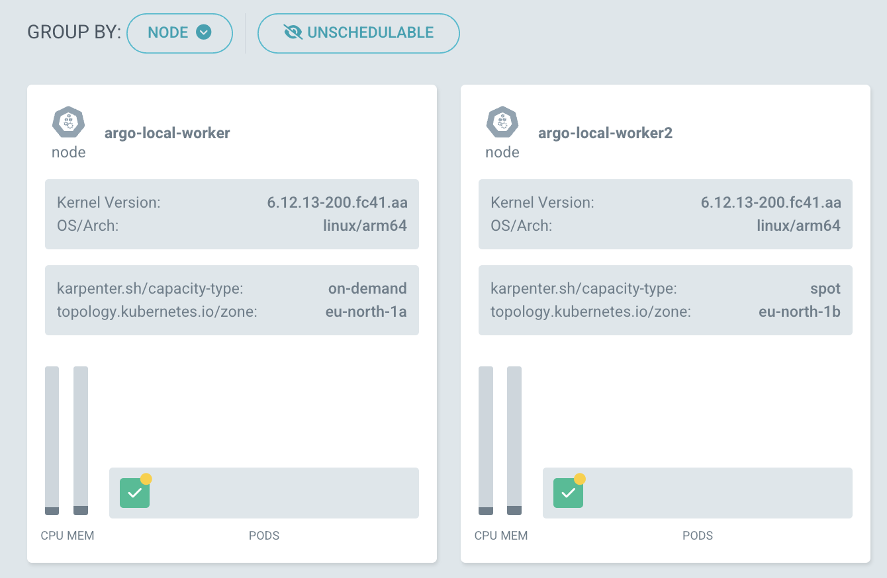

# UI Customization

## Default Application Details View

By default, the Application Details will show the `Tree` view.

This can be configured on an Application basis, by setting the `pref.argocd.argoproj.io/default-view` annotation, accepting one of: `tree`, `pods`, `network`, `list` as values.

For the Pods view, the default grouping mechanism can be configured using the `pref.argocd.argoproj.io/default-pod-sort` annotation, accepting one of: `node`, `parentResource`, `topLevelResource` as values.

## Node Labels in Pod View

It's possible to propagate node labels to node information in the pod view by configuring `application.allowedNodeLabels` in the [argocd-cm](argocd-cm-yaml.md) ConfigMap.

The following configuration:
```yaml
application.allowedNodeLabels: topology.kubernetes.io/zone,karpenter.sh/capacity-type
```
Would result in:


## Filtering the Pods View

The Pods view shows the **Resource filters** sidebar, so you can focus on the pods that need attention, for example pods in `CreateContainerConfigError`, or every pod except the `Completed` ones left by CronJobs. The following filters are available:

* **Name**: matches the pod name. Use `*` as a wildcard.
* **Sync Status**: matches the sync status of the pod's top-level resource, such as its Deployment, because pods are not synced directly. The counts next to the options are the numbers of those top-level resources, as in the other views.
* **Health Status**: matches the health of the pod itself.
* **Pod Status**: matches the pod status reason, which is the value that `kubectl get pods` shows in the `STATUS` column, for example `Running`, `Completed`, `CrashLoopBackOff` or `Init:Error`. The options are the statuses of the application's pods.
* **Namespaces**: shown when the pods span more than one namespace.

Values selected in the same filter are combined with OR, and different filters are combined with AND. The filters are stored in the `resource` query parameter of the URL, so you can share a link to a filtered view:

```text
/applications/argocd/my-app?view=pods&resource=podStatus:CrashLoopBackOff,podStatus:Error
```

> [!NOTE]
> The Kinds filter does not apply to the Pods view, and the Pod Status filter only applies to the Pods view.

## CLI Download Links

The **Help** page (linked from the bottom of the sidebar) always shows a download button for the Linux CLI binary that is embedded in the Argo CD server, so users can fetch a working CLI without any configuration.

To offer the CLI for additional operating systems and architectures, set `help.download.<os>-<arch>` keys in the [argocd-cm](argocd-cm-yaml.md) ConfigMap. Each configured key adds a download button on the Help page pointing at the URL you provide:

```yaml
apiVersion: v1
kind: ConfigMap
metadata:
  name: argocd-cm
  namespace: argocd
data:
  help.download.linux-amd64: "https://example.com/argocd-linux-amd64"
  help.download.linux-arm64: "https://example.com/argocd-linux-arm64"
  help.download.darwin-amd64: "https://example.com/argocd-darwin-amd64"
  help.download.darwin-arm64: "https://example.com/argocd-darwin-arm64"
  help.download.windows-amd64: "https://example.com/argocd-windows-amd64.exe"
```

The following `<os>-<arch>` keys are recognized; any other key is ignored:

- `linux-amd64`
- `linux-arm64`
- `linux-ppc64le`
- `linux-s390x`
- `darwin-amd64`
- `darwin-arm64`
- `windows-amd64`

> [!NOTE]
> The default Linux button is always shown in addition to any configured links, so configuring `help.download.linux-<arch>` for the server's own architecture results in two Linux buttons.
