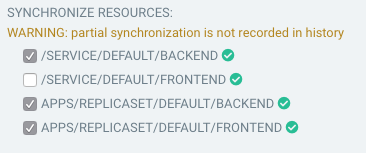

# Selective Sync

A _selective sync_ (also known as a _partial sync_ or _partial synchronization_ in the UI) is one where only some resources are sync'd. You can choose which resources from the UI or the CLI:

When doing so, bear in mind that:

- Your sync is **not** recorded in the history, and so rollback is not possible.
- [Hooks](sync-waves.md) are **not** run.

## Filtering Resources by Kind in the UI

When an application contains resources of more than one Kubernetes `Kind`, the **Synchronize resources** section of the Application Sync Panel displays a searchable **Filter by Kind** combo box.

- Select a `Kind` (or type in the combo box search input to filter a long list of Kinds) to display only resources of that `Kind`.
- Manual checkbox selections are preserved when switching between Kinds or returning to **All kinds**.
- While a `Kind` filter is active, use the **select visible** and **clear visible** links to bulk-select or clear only the resources of the currently selected `Kind` without affecting other Kinds.
- Clicking the global **all**, **out of sync**, or **none** links resets the active `Kind` filter back to **All kinds** and updates the selection across all resources.

> [!NOTE]
> The **Filter by Kind** combo box is a view filter. Any resources of other Kinds that remain checked while hidden by the filter will still be included when you click **Synchronize**.
