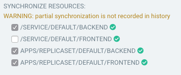

# Selective Sync

A _selective sync_ (also known as a _partial sync_ or _partial synchronization_ in the UI) is one where only some resources are sync'd. You can choose which resources from the UI or the CLI:



When doing so, bear in mind that:

- Your sync is **not** recorded in the history, and so rollback is not possible.
- [Hooks](sync-waves.md) are **not** run.

## Filtering resources by kind in the UI

The **Synchronize resources** list in the sync panel has three shortcuts: `all`, `out of sync` and `none`. If the application has more than one resource kind, the panel also shows one button for each kind, with the number of resources of that kind.

Select one or more kinds to hide all other resources in the list. The shortcuts then act only on the resources that are still visible, so you can combine them with the kind filter. For example, to sync only the out-of-sync Deployments, click `none`, select `Deployment`, then click `out of sync`.

> [!WARNING]
> The kind filter only hides resources. A resource that is hidden by the filter but still selected **is** synced. The panel shows a warning with the number of such resources and a `deselect them` button.

## Selecting resources by kind with the CLI

Use the `--resource` flag with a wildcard:

```bash
argocd app sync my-app --resource '*:Deployment:*' --resource '*:Service:*'
```
